

<b>Flick pineapples at jealous penguins. Defend your fruit stand. Nobody gets hurt.</b>

<a href="https://jnfoo.github.io/pineapple-defense/"><b>▶ Play it now</b></a> · free · one small file · works offline · no ads · no tracking

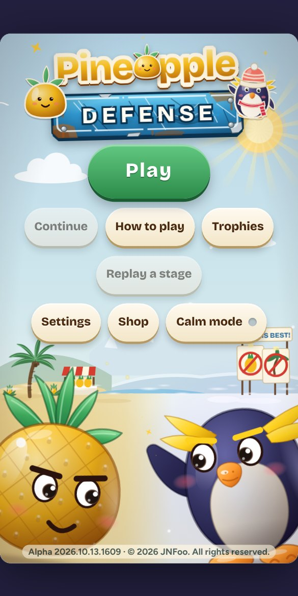
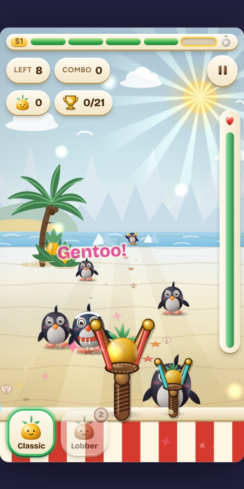
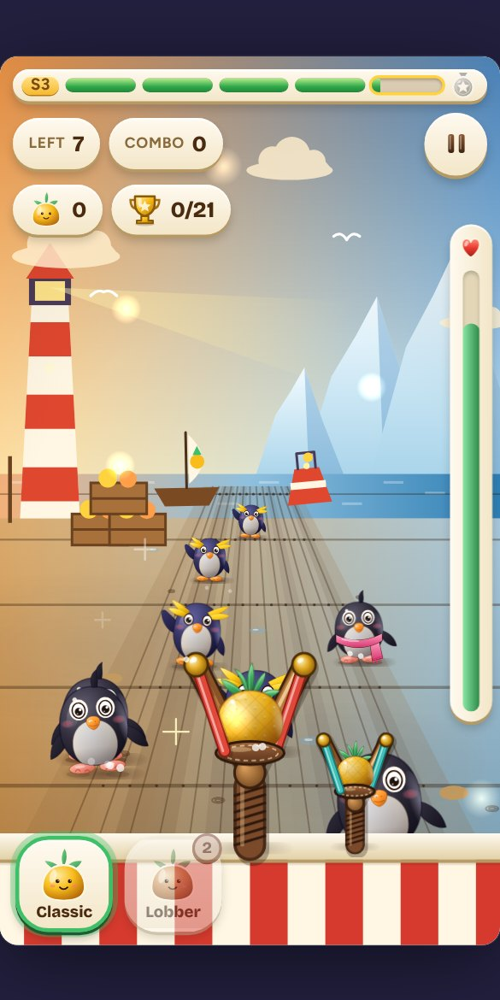
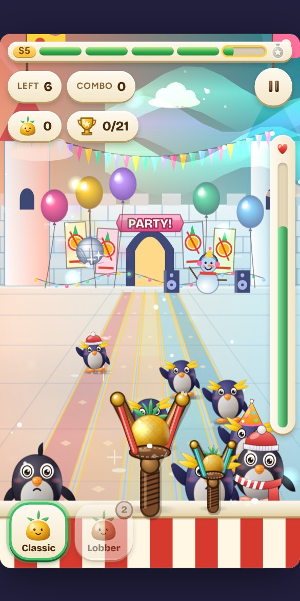

A silly, glossy toy-box game for kids of all ages. The penguins are jealous of your tropical fruit and march down the ice toward your stand. Flick a pineapple to bonk them, chain combos, collect trophies, and beat a different Champion at the end of every stage. It works on phones, tablets and computers, in any modern browser.

> **Status:** alpha, version 2026.10.13.1614 (see the [changelog](CHANGELOG.md)). All five stages, five Champions, the Pineapple Roll bonus game and a shop are playable. The art is still being polished.

## How to play

1. **Flick** up from the bottom of the screen toward a penguin (on a mouse or touchpad, swipe up over the game). A harder flick throws farther.
2. Penguins that reach your fruit stand make it wobble and lower the **Cheer** meter (the tall bar on the right). Clear waves to cheer it back up.
3. Each stage has five waves, shown by the bar across the top, then a **Champion**. Every Champion fights differently, and a hint tells you how to win.
4. Every penguin you bonk pays Golden Pineapples (Rockhopper 1, Adélie 3, Gentoo 6, Champion 12). Spend them in the **Shop** on the title screen.

**Handy things to know**

- Pick **Classic** (quick, free) or **Lobber** (slower, splashes nearby penguins, 2 Golden Pineapples a throw) at the bottom left. Mega pineapples splash the most and cost 3.
- Watch for **fish on parachutes**. A penguin that eats one levels up and gets faster and tougher, and a Gentoo that eats another becomes a **mecha penguin** with armor that takes 3 hits.
- Penguins wear all kinds of things: warm hats, scarves, mittens, and hot chocolate. Spotting one in a full outfit is a treat.
- **Combos:** every hit within a second and a half chains, whether it comes from your slingshot, a helper or one big splash.
- Tap the **pickups** that appear on your table, and the little **surprises** hiding in the scenery (a talking cloud, a duck, a whale, balloons you can pop). Each stage also hides one secret tap spot on each side.
- After stage 4 you can play **Pineapple Roll**, a carnival bonus game: flick a ball up the lane into the holes. The harder holes score more, and a ball that rattles around a rim can still drop in. You get two plays per run, and what you win becomes Golden Pineapples.
- **Runs:** clearing all five stages is a run. Each finished run makes penguins and Champions 10% faster (up to double speed) and brings a new challenge and more trophies.
- **Comfort** settings (title screen): left-handed layout, aim help, the dotted aim arc, high contrast, large text and a calm mode that turns off bobbing, confetti and other motion.
- Keys on a keyboard: **P** or **Esc** pauses, **R** calls the Pineapple Rain, **1** and **2** pick the pineapple.

## The five stages

| | | | | |
|:-:|:-:|:-:|:-:|:-:|
|  | 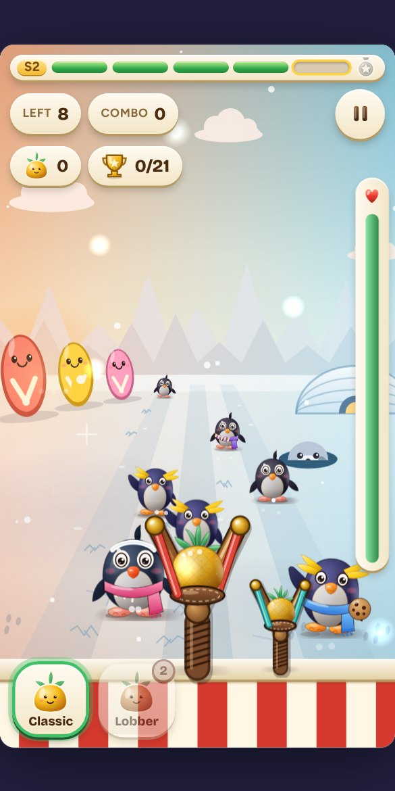 |  | 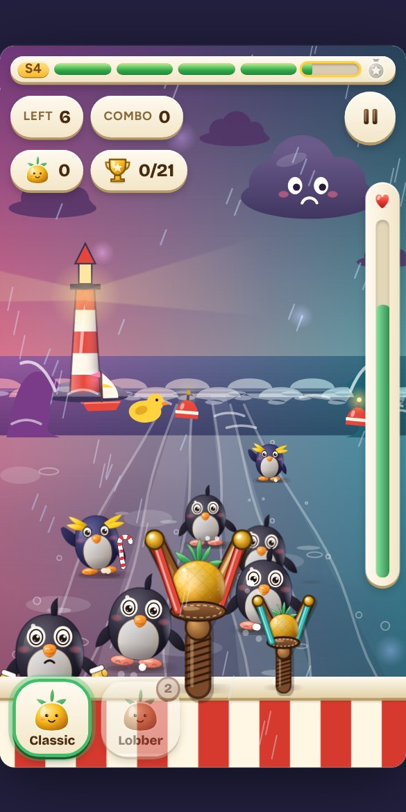 |  |
| **1. Sandy Snack Shore** Coach Waddles | **2. Flip-Flop Flats** Captain Flipper | **3. Iceberg Harbor Hullabaloo** Sir Slidealot | **4. Stormy Splash Sea** Madame Mohawk | **5. Glacier Party Fortress** Grand Champion Bernard |

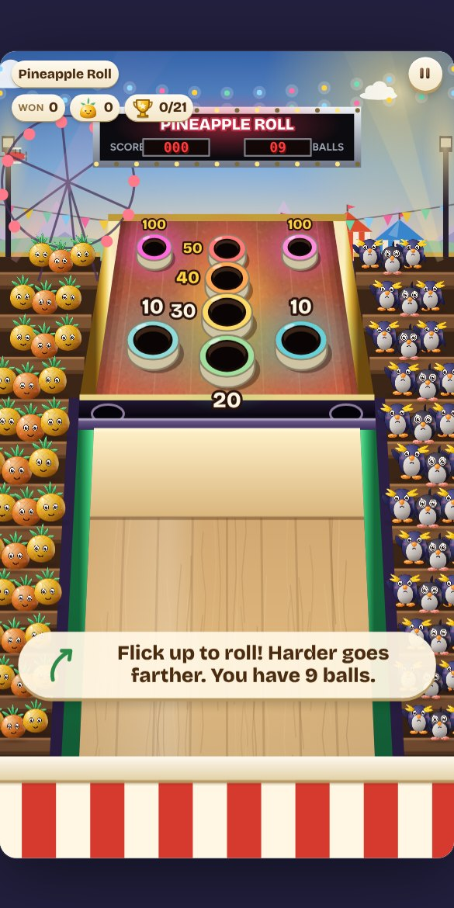 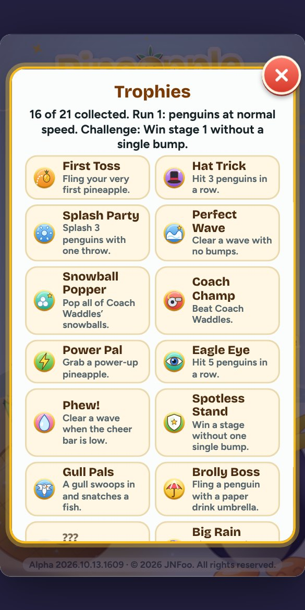 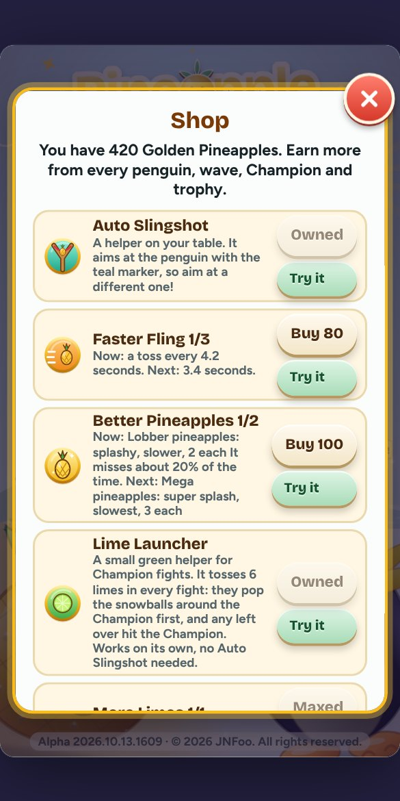

Pineapple Roll (the bonus game) · Trophies · Shop

## Shop upgrades

| | Upgrade |
|:-:|---|
| 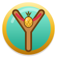 | **Auto Slingshot** A helper slingshot on your table that tosses pineapples for you. It aims at the penguin with the teal marker and sometimes misses. |
| 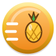 | **Faster Fling (3 levels)** Your helper tosses faster: every 5.2, then 4.2, 3.4 and 2.8 seconds. |
| 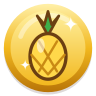 | **Better Pineapples (2 levels)** Unlocks the splashy **Lobber**, then the super-splashy **Mega** pineapple. |
| 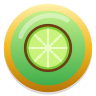 | **Lime Launcher** A small green helper for Champion fights. It pops the shields and snowballs around the Champion. |
| 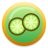 | **More Limes** 12 limes in every Champion fight. |
| 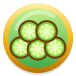 | **Lots of Limes** 20 limes in every Champion fight. |
|  | **Gull Pals (3 levels)** A gull swoops in and snatches falling fish, so fewer penguins level up. |
|  | **Paper Umbrellas (3 levels)** Drink umbrellas on your table snap open and fling away a penguin that is about to bump you. |
|  | **Pineapple Rain (2 levels)** Press the Rain button and a row of pineapples falls across the lanes. |

## Pickups

| | Pickup |
|:-:|---|
|  | **Zippy!** Super fast throws for 8 seconds. |
| 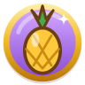 | **Mega!** Every throw splashes for 8 seconds. |
|  | **Cheer up!** Fills the cheer meter. |
|  | **Toasty!** Sleepy, slow penguins for 6 seconds. |

## 21 trophies

Trophies pay Golden Pineapples. They show as a gold icon when you have them and as a gray one when you do not.

| | Trophy | | Trophy |
|:-:|---|:-:|---|
| 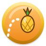 | **First Toss** Fling your very first pineapple. |  | **Hat Trick** Hit 3 penguins in a row. |
|  | **Splash Party** Splash 3 penguins with one throw. |  | **Perfect Wave** Clear a wave with no bumps. |
| 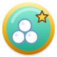 | **Snowball Popper** Pop all of Coach Waddles’ snowballs. |  | **Coach Champ** Beat Coach Waddles. |
|  | **Power Pal** Grab a power-up pineapple. |  | **Eagle Eye** Hit 5 penguins in a row. |
| 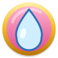 | **Phew!** Clear a wave when the cheer bar is low. |  | **Spotless Stand** Win a stage without one single bump. |
|  | **Gull Pals** A gull swoops in and snatches a fish. |  | **Brolly Boss** Fling a penguin with a paper drink umbrella. |
| 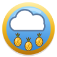 | **Pineapple Rain!** Make it rain pineapples. | 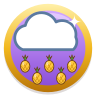 | **Big Rain** Hit 4 penguins with one Pineapple Rain. |
| 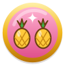 | **Team Spirit** Chain a combo with both slingshots. |  | **Combo Master** Reach a 6-hit combo. |
|  | **All Five!** Clear all five stages in one run. |  | **Faster Fun** Win a run when the penguins are a lot faster. |
|  | **Top Speed** Win a run when the penguins are super fast. | 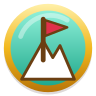 | **Challenger** Finish a run challenge. |
|  | **Grand Finale** End Pineapple Roll on a 100. | | |

## For developers

Everything is one self-contained HTML file built from `src/`. There are no runtime dependencies, no network calls and a strict content security policy.

- Design brief: [docs/pineapple-defense-design.md](docs/pineapple-defense-design.md) · QA and build process: [docs/qa-process.md](docs/qa-process.md) · ideas and performance audits: [docs/ideas-qol-and-performance.md](docs/ideas-qol-and-performance.md) · [changelog](CHANGELOG.md)
- Build: `python3 build.py` makes the single-file `index.html` from `src/` (needs `fonttools`). Do not edit `index.html` by hand.
- Packed single file: `python3 tools/pack.py` makes one smaller, self-unpacking `.html` in `dist/`; add `--min` to pack the minified page (`python3 build.py --min` first, needs `esbuild`).
- Icons: `python3 -I tools/make_icons.py` regenerates `src/sprites/icons.svg` and the standalone files in `docs/icons/`.
- Checks: `python3 -I tools/qa.py` (add `--ff` for Firefox). Release: `python3 -I tools/release.py`.
- Tested in Chromium and Firefox 158. Targets: Android Chrome, Firefox and Chromium-based desktop browsers.

## Credits and license

Copyright © 2026 JNFoo. All rights reserved.
Fonts: Bricolage Grotesque and Figtree (SIL OFL 1.1, see `src/fonts/`). `sticker-text` from JS-modules (MIT, see header in `src/vendor/`). LZMA decoder: lzma-js (MIT, see `src/vendor/lzma/`).
