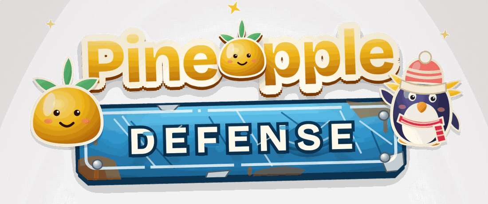
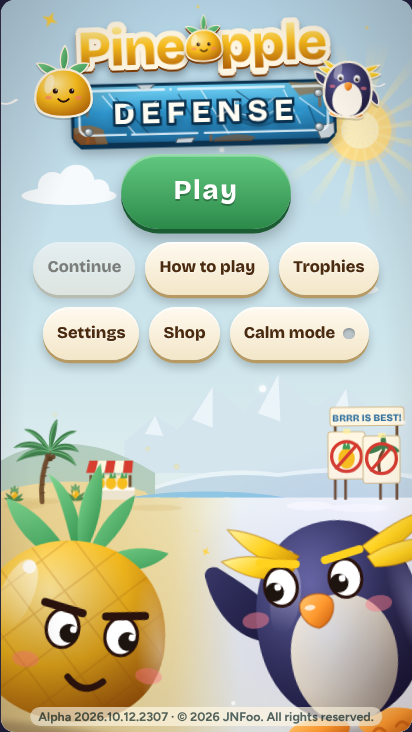
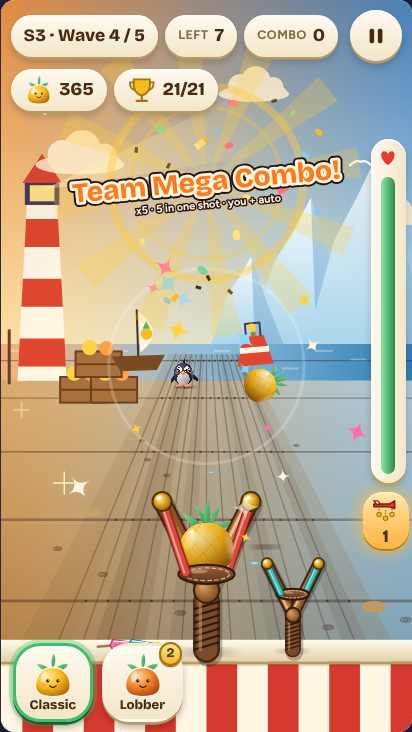
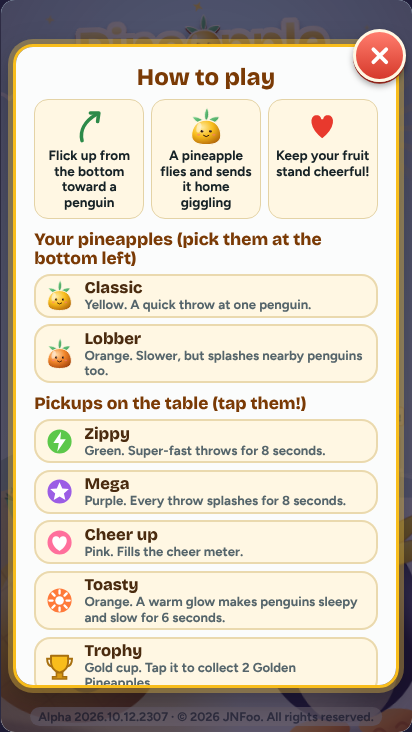
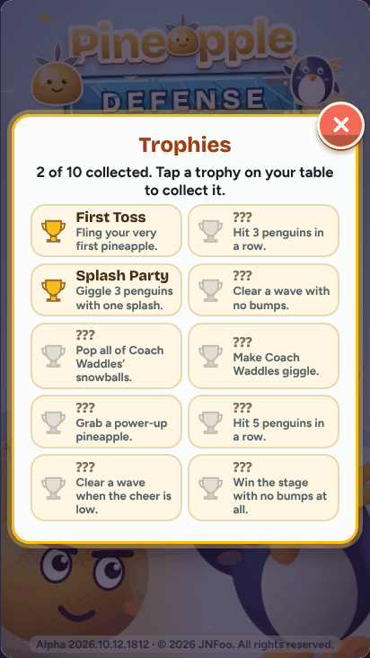
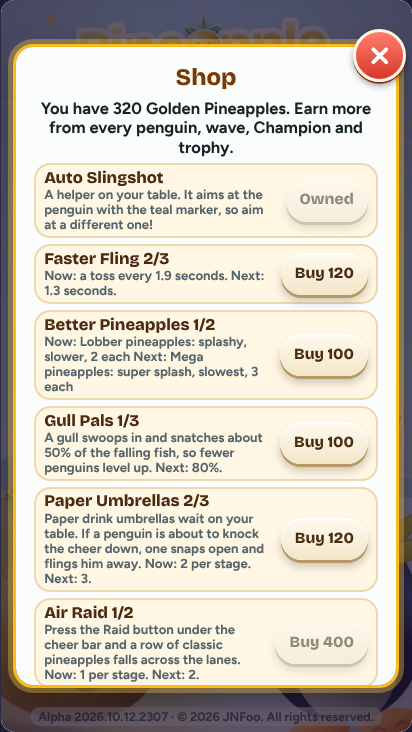

# Pineapple Defense

A free, silly browser game for kids of all ages: flick pineapples at penguins who are a little jealous of tropical fruit. Nobody gets hurt; everyone goes home giggling.

**Play it:** <https://jnfoo.github.io/pineapple-defense/> (one small file, works offline, no ads, no tracking)

**Status:** alpha. All five stages are playable, each with its own scenery, lanes, secret spots and Champion. Latest version: 2026.10.13.0008 (see the [changelog](CHANGELOG.md)). The art is still being polished.

## How to play

- Flick up from the bottom of the screen toward a penguin. On a touchpad or mouse, swipe up over the game.
- Penguins that reach your fruit stand make it wobble and lower the **Cheer** meter (the tall bar on the right). Clear waves to cheer it back up.
- Pick **Classic** (quick, free) or **Lobber** (slower, splashes nearby penguins, costs 2 Golden Pineapples a throw) at the bottom left. Mega pineapples (a pickup) splash the most and cost 3.
- Golden Pineapples are your bank, shown at the top. Every penguin pays out as you dispatch it: Rockhopper 1, Adélie 3, Gentoo 6, Champion 12.
- At the end of each stage a **Champion** waits with shields, dodges and helpers. Penguins walk around Champions rather than through them.
- Keep an eye out for **fish on parachutes**. A penguin that eats one levels up (Rockhopper, Adélie, Gentoo) and gets faster and tougher, but you can still hit it at any moment.
- Tap the **pickups** on your table: Zippy (fast throws), Mega (splash), Cheer up and Toasty (sleepy, slow penguins). Trophies pay Golden Pineapples. Each stage also hides one secret tap spot on each side.
- **Combos:** every hit within a second and a half chains, whether it comes from your slingshot, the Auto Slingshot or one big splash. The call gets louder as the chain grows.
- **Shop** (title screen): Auto Slingshot, Faster Fling, Better Pineapples, **Lime Launcher** (a small green helper for Champion fights, 3 tiers: its lime missiles pop the Champion's snowballs first and any left over hit the Champion), **Gull Pals** (gulls snatch the falling fish), **Paper Umbrellas** (a last resort that flings a penguin about to knock the cheer down) and **Air Raid** (a row of pineapples falls across the lanes where the most penguins are; press the Raid button or R).
- **Runs:** clearing all five stages is a run. Each finished run makes penguins and Champions 10% faster (up to double speed) and brings a new challenge and more trophies. Losing a wave and trying again keeps your streak; quitting the run and starting over from stage 1 resets it. After a run you can **Save and restart** or **Reset completely** (trophies always stay).
- **Comfort** (Settings): left-handed layout, aim help (Generous, Normal, Off) and the dotted aim arc, high contrast, large text, calm mode. After a pause you get a 3, 2, 1 before the penguins move. **Try it** in the shop runs a short demo of an upgrade without spending anything, and **Undo** refunds the last purchase. **Replay** (title screen) replays any cleared stage for full credits without touching your saved run, and keeps a best score per stage. The title screen shows your next goal.
- Keys: P or Esc pauses, R calls the Air Raid, 1 and 2 pick the pineapple. Calm mode (title screen) turns off bobbing, confetti and other motion.

## Project

- Design brief: [docs/pineapple-defense-design.md](docs/pineapple-defense-design.md)
- Changelog: [CHANGELOG.md](CHANGELOG.md)
- QA and build process: [docs/qa-process.md](docs/qa-process.md)
- Build: `python3 build.py` makes the single-file `index.html` from `src/` (needs `fonttools`). Don't edit `index.html` by hand.
- Packed single file: `python3 tools/pack.py` makes one smaller, self-unpacking `.html` in `dist/`; add `--min` to pack the minified page (`python3 build.py --min` first, needs `esbuild`).
- Checks: `python3 -I tools/qa.py` (add `--ff` for Firefox). Release: `python3 -I tools/release.py`.
- Tested in Chromium and Firefox 158. Targets: Android Chrome, Firefox and Chromium-based desktop browsers.

Copyright © 2026 JNFoo. All rights reserved.
Fonts: Bricolage Grotesque and Figtree (SIL OFL 1.1, see `src/fonts/`). `sticker-text` from JS-modules (MIT, see header in `src/vendor/`). LZMA decoder: lzma-js (MIT, see `src/vendor/lzma/`).
